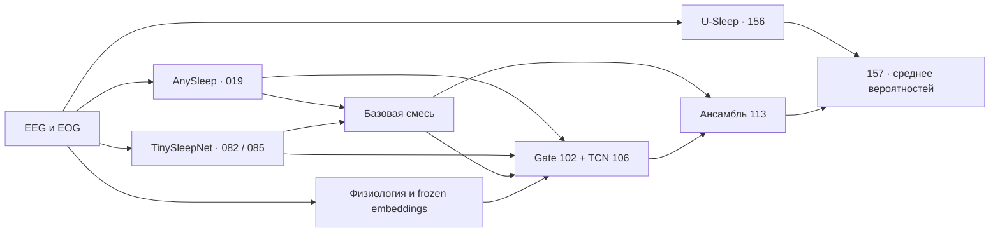

# Sleep-EDF 2026

**SBMTeam · 5 стадий сна · EEG / EOG · PyTorch**

Классификация 30-секундных эпох сна по двум EEG-каналам и одному EOG.
Финальное решение объединяет U-Sleep, AnySleep, дообученные TinySleepNet
и два небольших корректора над их предсказаниями.

[Выполненный Kaggle Notebook](https://www.kaggle.com/code/sevaperetiatko/sleep-edf-sbmteam?scriptVersionId=366571096)
· [PDF с результатами](final/pdf/06_final.pdf)
· [История экспериментов](docs/experiments.md)
· [Воспроизведение](docs/reproducibility.md)

## Результат

| Оценка | Финальный ансамбль `157` |
|---|---:|
| Provided validation macro-F1 | **0.923672** |
| Public leaderboard, выбранная отправка | **0.90055** |
| Тестовых эпох | 66 222 |
| Несовпадающих меток при воспроизведении | **0** |
| Полный Kaggle-run с подготовкой окружения | **925.9 с · 15 мин 26 с** |

Выполненный notebook сохранён с выводами ячеек. Проверка сравнивает все пары
`id,label`, а не только метрику. [Отчёт запуска](final/evidence/run_report.json).
Validation и public leaderboard — разные оценки. Validation многократно
использовалась при разработке; ограничения описаны в [протоколе оценки](docs/reproducibility.md#валидация-и-ограничения).

## Как устроено решение



`P157 = 0.50 × P156 + 0.50 × P113`.
Каждая модель использует свой зафиксированный preprocessing. Временной контекст
не пересекает записи и разрывы между эпохами. При финальном запуске обучение
не выполняется, признаки и прогнозы рассчитываются заново из raw test.
[Архитектура и численные соглашения](docs/solution.md).

## Запуск на Kaggle

1. Откройте [финальный notebook](final/notebooks/06_final.ipynb).
2. Подключите три фиксированных Input из [инструкции запуска](docs/reproducibility.md#inputs).
3. Выберите **T4 × 2**, **Internet Off** и выполните **Run All**.

По умолчанию создаётся `submission.csv` для `157`.
`OUTPUT_SECOND_SUBMISSION=True` также экспортирует `113` как `submission_2.csv`;
это необязательный выход компонента ансамбля. Для основного решения флаг не нужен.
GitHub-токен, загрузка весов и установка пакетов из сети не требуются.

## Структура

```text
final/             Автономный inference, выполненный notebook, PDF, веса и тесты
archive/           Исследовательский код, конфигурации и notebooks
docs/             Решение, эксперименты, воспроизводимость и источники
experiments.csv    Полный индекс 158 экспериментов со статусами
```

В `experiments.csv` сохранены 149 завершённых, 8 архивированных и 1 прерванный
эксперимент. Исследовательские данные, кэши, окружения и ZIP не входят в репозиторий.
В `final/weights` оставлены только девять файлов, нужных для `157`.
[Источники моделей и условия использования](docs/sources.md).
