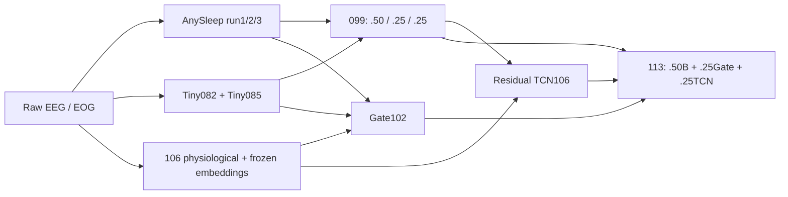

# Выбранное решение

Данные:30-секундные эпохи EEG Fpz-Cz, EEG Pz-Oz, horizontal EOG,100Hz,µV.
Выход — W,N1,N2,N3,REM. Два EEG и EOG обрабатываются с сохранением исходной временной
сетки; пропуски epoch_index разделяют непрерывные сегменты. В test нет читаемых меток.

019 — равное среднее softmax probabilities трёх AnySleep. Preprocessing:
µV→V, resample_poly128/100, clip±20IQR и RobustScaler отдельно по непрерывному сегменту.
Сохранён проверенный блочный inference core128/halo64 и encoder grid16; это намеренно
не full-record attention. Новые размеры контекста147–155 не заменили финал.

082 — classifier-only TinySleepNet FT;085 — full FT с sqrt class weights.
EEG Fpz-Cz вµV фильтруется Butterworth .3–40Hz order5 SOS filtfilt.
Rolling L20 использует начальное окно и последнюю позицию следующих окон;
исходные CNN64/LSTM16 batches сохранены. PhysioEx voting не включается.

102 — MLP gate136→64→64→3 над30 confidence и106 физиологическими признаками.
106 — residual TCN context20 над30 confidence + оригинальными Tiny contextual128
и AnySleep run1 pre-classifier6. Embeddings используют исходные batches256/256
и AnySleep4; они не подменены embeddings дообученной085.

Для обоих heads используются сохранённые mean/std full-train refit; fit в финале нет.
Heads выполняются глобальными batches4096 и512 с исходным CUDA float16 autocast.
Backbones работают float32. Padding маскируется; контекст не пересекает записи/разрывы.

099 вычисляет .5P019+.25P082+.25P085 вfloat64 и нормализует строки один раз.
113 в исходном коде сначала нормализует три экспертные вероятности вfloat32,
вычисляет B вfloat64 без промежуточного float32 округления и смешивает его с heads.
Эта небольшая численная особенность сохранена; CSV099 не служит входом для113.

Последние два больших dilation в TCNcontext20 не увеличивают центральный контекст.
Архитектуру готового checkpoint не меняли. Компоненты переиспользуют тех же экспертов;
это не пять независимых моделей. Все тестовые ID соединяются с sample_submission по ID.
